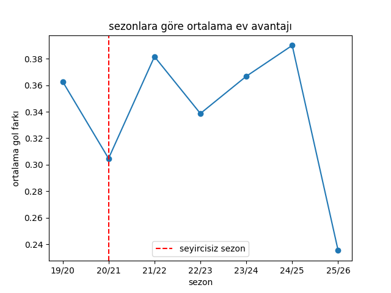

# Süper Lig'de Seyircisiz Dönem: Ev Sahibi Avantajının Kaynağı Seyirci mi?

COVID-19 salgını sırasında Süper Lig maçları bir süre seyircisiz oynandı. Bu durum, seyircinin ev sahibi avantajına etkisini incelemek için bir doğal deney fırsatı sundu. Bu projede 2019/20 – 2025/26 arasındaki 7 sezonu kullanarak seyircili ve seyircisiz maçlarda ev sahibi avantajının değişip değişmediğini istatistiksel yöntemlerle inceledim.

**Araştırma sorusu:** Seyircisiz oynanan maçlarda ev sahibi takımların avantajı azaldı mı?

Analizlerin bütün ayrıntıları, grafikler ve yorumlar [rapor.pdf](rapor.pdf) dosyasında.

## Veri

- **Kaynak:** football-data.co.uk Süper Lig verileri (GitHub'daki bir yansıması üzerinden indirildi, bkz. `kod/veri.py`)
- **Kapsam:** 7 sezon, 2019/20 – 2025/26
- **Maç sayısı:** 2476 maç indirildi. Maç istatistikleri olmayan 31 maç çıkarıldı (bunlar hükmen 3-0 sonuçlanan maçlar; çoğu 2023 depremi sonrası ligden çekilen Hatayspor ve Gaziantep FK'nın maçları). Analizde **2445 maç** kullanıldı.
- **Seyircisiz dönem:** 12 Mart 2020 – 30 Haziran 2021 arası maçlar (**502 maç**). Geri kalan **1943 maç** seyircili dönem olarak alındı.
- **Kullanılan değişkenler:** skor, sonuç, şut, isabetli şut, korner, faul, sarı/kırmızı kart ve Bet365 bahis oranları.

Oluşturduğum değişkenler:

| Değişken | Tanım |
|---|---|
| `gol_farki` | Ev sahibi golü − deplasman golü (ev sahibi avantajının ana ölçüsü) |
| `ev_kazandi` | Ev sahibi kazandıysa 1, kazanamadıysa 0 |
| `toplam_gol` | Maçtaki toplam gol |
| `seyircisiz` | Maç seyircisiz dönemde oynandıysa 1, seyircili dönemde 0 |
| `sut_farki`, `isabetli_sut_farki`, ... | Ev sahibi − deplasman farkları |

## Kullanılan yöntemler

- Tanımlayıcı istatistikler, histogram, kutu grafiği
- Normallik incelemesi: çarpıklık, basıklık, Shapiro-Wilk testi, Q-Q grafikleri
- Aykırı değer incelemesi (z-skoru)
- Welch t-testi ve farkın %95 güven aralığı
- Mann-Whitney U testi (dayanıklılık kontrolü)
- İki oran z-testi (ev sahibinin kazanma oranı)
- Ki-kare bağımsızlık testi (galibiyet / beraberlik / mağlubiyet dağılımı)
- Tek yönlü ANOVA (sezonlar arası fark)
- Güç analizi (minimum saptanabilir etki, MDE)
- Pearson ve Spearman korelasyonu, korelasyon matrisi
- Doğrusal regresyon (OLS): tek değişkenli model ve takım sabit etkili model, artık analizi
- Takım bazında karşılaştırma
- Bahis oranlarından ima edilen olasılıklar
- Duyarlılık analizi (sadece tamamen seyircili / seyircisiz sezonlar, aykırı değerler çıkarılmış veri)

## Ana bulgular

| Analiz | Sonuç |
|---|---|
| Ortalama gol farkı | Seyircili 0.349, seyircisiz 0.311 |
| Welch t-testi (gol farkı) | t = −0.46, p = 0.649, farkın %95 GA: [−0.203, 0.126] |
| Mann-Whitney U (gol farkı) | p = 0.481 |
| Ev sahibinin kazanma oranı | %45.3 → %42.6, p = 0.285 |
| Ki-kare (maç sonucu × dönem) | χ² = 1.22, p = 0.543 |
| ANOVA (sezonlar) | F = 0.31, p = 0.931 |
| Regresyon, takım etkileri kontrol edilince | seyircisiz katsayısı +0.007, p = 0.938 |
| Bahisçilerin ev sahibi galibiyet olasılığı | %44.2 → %42.5, p = 0.023 |
| Duyarlılık analizleri | p = 0.742 (temiz sezonlar), p = 0.329 (aykırısız) |

**Sonuç:** Seyircisiz dönemde ev sahibi avantajında küçük bir düşüş eğilimi görülüyor, ancak bu düşüş istatistiksel olarak anlamlı değil. Takımların gücü hesaba katıldığında seyircisiz dönemin etkisi neredeyse sıfıra iniyor. Sonuç, farklı tanım ve veri seçimlerinde de değişmedi. Ev sahibi avantajının büyük kısmı seyirci dışındaki etkenlerden (saha alışkanlığı, yolculuk, takım gücü vb.) kaynaklanıyor gibi görünüyor.

Bununla birlikte, güç analizine göre bu veriyle ancak yaklaşık 0.24 gollük (mevcut ev avantajının ~%67'si) bir etki güvenilir şekilde yakalanabiliyor. Bu yüzden seyircinin küçük bir etkisinin olmadığını kesin olarak söyleyemiyorum.



## Klasör yapısı

```
superlig_seyirci_etkisi/
├── kod/
│   ├── veri.py          # sezon verilerini indirir
│   ├── birlestir.py     # sezonları birleştirir, temizler, yeni değişkenleri oluşturur
│   ├── analiz.py        # bütün analizler ve grafikler
│   └── kontrol.py       # kütüphane sürümlerini kontrol eder
├── veri/
│   ├── ham/             # indirilen sezon dosyaları (T1_1920.csv ... T1_2526.csv)
│   └── temiz/           # analizde kullanılan veri (superlig_temiz.csv)
├── grafikler/           # analizde üretilen grafikler
├── rapor.pdf            # proje raporu
├── requirements.txt
└── README.md
```

## Kurulum ve çalıştırma

```bash
python -m venv .venv
.venv\Scripts\activate          # Windows (Mac/Linux: source .venv/bin/activate)
pip install -r requirements.txt

python kod/veri.py              # 1. verileri indir
python kod/birlestir.py         # 2. birleştir ve temizle
python kod/analiz.py            # 3. analizleri çalıştır
```

## Kullanılan kütüphaneler

Python 3, pandas, NumPy, matplotlib, seaborn, SciPy, statsmodels

## Sınırlılıklar

- Seyircisiz dönem yaklaşık bir buçuk sezonu kapsıyor; bu yüzden örneklem sınırlı ve küçük etkileri yakalama gücü düşük.
- Ligdeki takımlar sezondan sezona değişiyor. Bunu takım kuklalarıyla kontrol etmeye çalıştım, ancak bu yöntem takım gücünün 7 sezon boyunca sabit kaldığını varsayıyor.
- 2019/20 sezonu hem seyircili hem seyircisiz maçlar içeriyor, 2021/22 ise salgın kısıtlamalarının sürdüğü bir geçiş sezonuydu. Bu iki sezonu dışarıda bırakarak yaptığım duyarlılık analizi aynı sonucu verdi.
- Çok sayıda test yaptığım için tek başına anlamlı çıkan bahis oranı sonucunu (p = 0.023) temkinli yorumladım.

## Yapay zekâ kullanımı

Bu projede yapay zekâ aracı Claude'u (Anthropic) bir çalışma asistanı olarak kullandım. Projedeki bütün Python kodlarını kendim yazdım; eksik kaldığım noktalarda yapay zekâdan yardım aldım. Analizleri kendim yaptım; gerektiğinde yöntem seçimlerimi ve sonuçların yorumunu yapay zekâyla tartıştım, kodumdaki hataları da birlikte düzelttik. Raporlama aşamasında, raporun hazırlanmasında da yapay zekâdan destek aldım. Rapordaki bütün sayılar kendi kodumun çıktılarından alındı.

## Hazırlayan

Salih Korkmaz – Hacettepe Üniversitesi, İstatistik Bölümü
